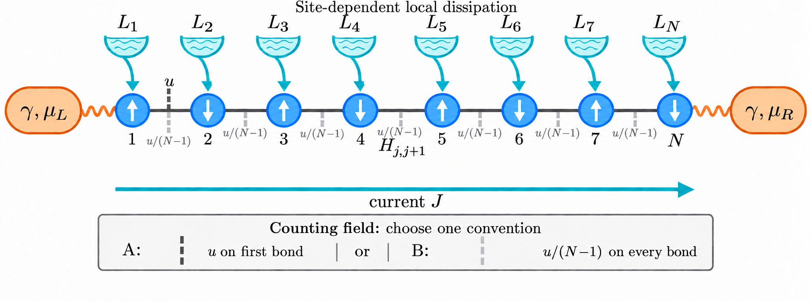

# Tilted XXZ dynamics and GCF analysis

This folder contains a deterministic tensor-network simulation of a tilted,
boundary-driven XXZ chain and a Julia notebook for extrapolating finite-size
tilted-Liouvillian eigenvalues. The simulation uses a vectorized density matrix
stored as an MPS, TEBD time evolution, and Pauli operators. Simulation files use
HDF5; the precomputed eigenvalues and reference curve use CSV.

The main files are:

| File | Purpose |
|---|---|
| `simulation_GCF.jl` | Physical model, tilted Liouvillian, TEBD gates, measurements, evolution, HDF5 output, and command-line interface. |
| `Hs_and_Ls.jl` | Copy-ready XXZ, transverse-field Ising, and XY Hamiltonians plus common local Lindblad dissipators. |
| `mpdo_basics.jl` | Pauli matrices, ket/bra operator-space operators, MPDO site definition, identity MPS, and measurement contractions. |
| `run_example.jl` | Editable small-run interface and commented code for creating an infinite-temperature initial state. |
| `GCF_from_eigenvalues.ipynb` | Five GCF extrapolation methods and plots of the six-site simulation. |
| `Project.toml`, `Manifest.toml` | Dependencies and the resolved Julia environment. |
| `eigenvalues.csv` | 64 eigenvalues: chi=100,120; N=40,70,100,200; eight u values. |
| `ISEP_theory.csv`, `provenance.json` | Supplied ISEP reference curve and input provenance. |
| `initial_N6.h5` | Infinite-temperature six-site starting MPS at t=0. |
| `data.h5`, `rho.h5` | Example measurement history and final checkpoint. |
| `spin_chain_lindblad_dissipation.png` | Model diagram displayed below. |

All required files and exported PDF figures are in this directory; no data or
figure subdirectories are needed.

## Step-by-step: run the code

### 1. Enter the project and install its environment

The code was tested with Julia 1.11.3. `Project.toml` and `Manifest.toml` pin the
environment.

```bash
cd /path/to/Open-Systems-and-Current-Fluctuations
julia --project=. -e 'using Pkg; Pkg.instantiate()'
```

Use `--project=.` from this directory so Julia loads the intended packages.

### 2. Create an HDF5 initial state

Start Julia with `julia --project=.` and run the following. Change `L` and the
filename as needed:

```julia
include("simulation_GCF.jl")

L = 6
sites = siteinds("mpdo=1/2", L; conserve_qns=QNcharge)
rho = ident(sites)

# ident(sites) is the unnormalized identity. Dividing every local tensor by 2
# gives rho = I/2^L, whose trace is one.
for j in eachindex(sites)
    rho[j] /= 2
end

h5open("initial_N6.h5", "w") do file
    write(file, "t", 0.0)          # physical starting time
    write(file, "rho", rho)       # MPS, including Index IDs and QN blocks
    write(file, "log_scale", 0.0) # no normalization has yet been removed
end
```

An input file must contain `t` and `rho`. `log_scale` is optional; if it is
absent, the simulation starts it at zero.

### 3. Edit the readable example settings

Open `run_example.jl` and edit this block:

```julia
directory = @__DIR__  # default output: this folder
chi_low = 16
chi = 32
cf = 1e-10
eps, eta, Da = -1.0, 0.2, 0.5
mu, gamma, count_u = 0.3, 1.0, -0.5
delta = 0.01
Steps = 100
Steps_low_chi = 50
save_step = 5
scheme = "TEBD2"
observables = ["current", "zz_correlation"]
```

Run it with the initial state and, optionally, an output directory:

```bash
julia --project=. run_example.jl initial_N6.h5 .
```

If the second argument is omitted, output goes to the folder containing
`run_example.jl`. The distributed initial file is already available; recreate it
with the block above when changing the system size. The script first
runs a five-site, ten-step compilation warm-up in a temporary directory. This
compiles gate application, measurements, and HDF5 writing before the main run is
timed. It does not evolve or modify the user's input state, and its memory use is
not an estimate for the requested system.

### 4. Inspect the two output files

The selected output directory contains:

```text
data.h5   # measurement histories and parameters
rho.h5    # latest MPS checkpoint, time, normalization, and parameters
```

Read ordinary datasets and the MPS as follows:

```julia
using HDF5, ITensors, ITensorMPS

data = h5open(read, "data.h5", "r")
times = data["t"]
log_trace = data["Log_trace"]
current = data["current"]           # present only if requested
zz = data["zz_correlation"]         # present only if requested

rho = h5open("rho.h5", "r") do file
    read(file, "rho", MPS)
end
```

### 5. Continue a saved state

`Steps` always means additional steps after the time stored in the input file.
Use `rho.h5` as the next input and choose a new output directory if the preceding
segment should be preserved:

```bash
julia --project=. run_example.jl \
    rho.h5 \
    results/my_second_segment
```

The new `data.h5` contains only the new segment, beginning at the loaded time. It
does not merge the preceding measurement file.

### 6. Run `simulation_GCF.jl` directly

The command-line order is:

```text
initial_file directory chi chi_low cf eps eta Da mu gamma count_u delta Steps Steps_low_chi save_step observables [scheme]
```

Example:

```bash
julia --project=. simulation_GCF.jl \
    initial_N6.h5 . \
    32 16 1e-10 \
    -1.0 0.2 0.5 0.3 1.0 -0.5 \
    0.01 100 50 5 \
    current,zz_correlation TEBD2
```

`scheme` is optional and defaults to `TEBD2`. The direct command performs the
same compilation warm-up as `run_example.jl`.

## User parameters

| Parameter | Meaning |
|---|---|
| `initial_file` | HDF5 file containing starting `t`, MPS `rho`, and optional `log_scale`. |
| `directory` | Destination containing `data.h5` and `rho.h5`; `mkpath` creates it if needed. Existing files with these names are overwritten at checkpoints. |
| `L` | Number of physical sites, inferred from the loaded MPS. |
| `eps` | XX/YY exchange coefficient. Its sign and magnitude also enter the physical magnetization current. |
| `Da` | XXZ anisotropy multiplying `sigma_z*sigma_z`. |
| `eta` | Bulk dephasing rate; every site has jump `sqrt(eta)*sigma_z`. |
| `mu` | Opposite reservoir polarization bias. The boundary rates require `abs(mu) <= 1`. |
| `gamma` | Boundary coupling rate; use `gamma >= 0`. |
| `count_u` | Total current-counting field distributed over all `L-1` bonds. |
| `delta` | Physical duration of one complete TEBD step. |
| `Steps` | Number of additional TEBD applications. Final time is `t0 + Steps*delta`. |
| `chi_low` | Maximum bond dimension during the first `Steps_low_chi` applications. |
| `Steps_low_chi` | Number of initial applications made with `chi_low`; zero applies `chi` immediately. |
| `chi` | Maximum bond dimension afterward. It is a cap; the actual rank may be smaller. |
| `cf` | SVD discarded-weight cutoff passed to `apply`. |
| `save_step` | Measurement interval. Step zero and the final step are always measured. |
| `observables` | Any nonempty subset of `current` and `zz_correlation`. Only selected arrays are allocated and saved. |
| `scheme` | `TEBD`, `TEBD2`, or `TEBD4`. |

Check convergence separately in `delta`, `chi`, `cf`, evolution time, and system
size. A larger `chi` cannot repair a time step that is too large, and a small
cutoff does not prove that the bond dimension is sufficient.

## Physical model and conventions



*Each site $j$ may have its own local Lindblad jump operator, represented by
$L_j$ in the figure. In the present example, `Lind_Dissipator` applies
`sqrt(eta)*sigma_z` on every site and adds the reservoir jumps at the two
boundaries. To study nonuniform dissipation, use the site index `j` inside that
function to define a different `jumps` list at each site. The teal arrow is the
current $J$. The gray annotations are two alternative counting conventions:
place the full field $u$ on the first bond, or distribute $u/(L-1)$ uniformly
over all bonds. The current `H_oper` uses the uniform convention. Its ket and
bra hopping factors contain $u/[2(L-1)]$ because the two vectorized branches
together give the bond field $u/(L-1)$.*

### XXZ Hamiltonian and tilt

At zero counting field,

\[
H=\epsilon\sum_{j=1}^{L-1}\left(
\sigma_j^x\sigma_{j+1}^x+
\sigma_j^y\sigma_{j+1}^y+
\Delta\sigma_j^z\sigma_{j+1}^z\right),
\qquad \Delta=\texttt{Da}.
\]

Using \(\sigma^\pm=(\sigma^x\pm i\sigma^y)/2\),

\[
\sigma^x\sigma^x+\sigma^y\sigma^y
=2(\sigma^+\sigma^-+\sigma^-\sigma^+).
\]

This Pauli identity explains the factors of two in `H_oper`. The tilted terms are

\[
H_u=\epsilon\sum_j\left[
2e^{-u/[2(L-1)]}\sigma_j^+\sigma_{j+1}^-+
2e^{u/[2(L-1)]}\sigma_j^-\sigma_{j+1}^++
\Delta\sigma_j^z\sigma_{j+1}^z\right].
\]

The coherent vectorized generator represents
\(-i(H_u\rho-\rho H_{-u})\). At `count_u=0` it is the usual commutator. At
nonzero field, the tilted generator generally does not preserve trace.

### Lindblad operators

The bulk and boundary jumps are

\[
J_j=\sqrt{\eta}\,\sigma_j^z,
\]

\[
J_{1,+}=\sqrt{\gamma(1-\mu)}\,\sigma_1^+,
\quad J_{1,-}=\sqrt{\gamma(1+\mu)}\,\sigma_1^-,
\]

\[
J_{L,+}=\sqrt{\gamma(1+\mu)}\,\sigma_L^+,
\quad J_{L,-}=\sqrt{\gamma(1-\mu)}\,\sigma_L^-.
\]

Every jump contributes

\[
\mathcal D[J](\rho)=J\rho J^\dagger-
\frac12\{J^\dagger J,\rho\}.
\]

### Vectorized density matrix

The local ordering and row-vectorization convention are

\[
|\rho\rangle\!\rangle=
(\rho_{\uparrow\uparrow},\rho_{\uparrow\downarrow},
\rho_{\downarrow\uparrow},\rho_{\downarrow\downarrow})^T,
\qquad
|A\rho B\rangle\!\rangle=(A\otimes B^T)|\rho\rangle\!\rangle.
\]

| Names | Local matrix | Action |
|---|---|---|
| `K_x,K_y,K_z,K_p,K_m` | `sigma_a kron I` | Left multiplication by the Pauli operator. |
| `B_x,B_y,B_z,B_p,B_m` | `I kron sigma_a` | Right multiplication by the transposed Pauli operator. |
| `Iden` | `I kron I` | Identity in local operator space. |

Because of the transpose, `B_p` represents right multiplication by
`sigma_minus`, `B_m` by `sigma_plus`, and `B_y` by `-sigma_y`.

`QNcharge=true` gives the operator-space site a conserved ket-minus-bra charge.
`K_p/K_m` and `B_p/B_m` have definite charge changes and work with these blocks.
`K_x/K_y` and `B_x/B_y` mix opposite changes and are rejected on QN sites. Use
the ladder decomposition or create sites with `conserve_qns=false` when a new
model breaks this symmetry.

### Measured observables

The Pauli magnetization current follows from the continuity equation:

\[
i[H_{i,i+1},\sigma_i^z]=-j_i,
\qquad
j_i=2\epsilon(\sigma_i^x\sigma_{i+1}^y-
\sigma_i^y\sigma_{i+1}^x)
=4i\epsilon(\sigma_i^+\sigma_{i+1}^--
\sigma_i^-\sigma_{i+1}^+).
\]

Hence \(d\langle\sigma_i^z\rangle/dt=
\langle j_{i-1}-j_i\rangle\) in the bulk. The current for
\(S^z=\sigma^z/2\) is half the saved Pauli magnetization current.

The connected correlation is

\[
C_{ij}^{zz}=\langle\sigma_i^z\sigma_j^z\rangle-
\langle\sigma_i^z\rangle\langle\sigma_j^z\rangle.
\]

`measure_mpdo_long` divides every measurement by `Tr(rho)`, including for a
tilted state. Current measured at nonzero `count_u` is an expectation in that
tilted state; it is not automatically the derivative of the dominant eigenvalue.

## TEBD evolution and normalization

`local_generators` embeds every one-site dissipator exactly once into neighboring
two-site generators. Odd and even bonds form disjoint layers.

| Scheme | Applied layers | Global order at fixed final time |
|---|---|---:|
| `TEBD` | `A(delta), B(delta)` | 1 |
| `TEBD2` | `A(delta/2), B(delta), A(delta/2)` | 2 |
| `TEBD4` | Five TEBD2 steps with weights `p,p,1-4p,p,p` | 4 |

Here \(p=1/(4-4^{1/3})\). The central TEBD4 weight is negative and may amplify
numerical error. TEBD2 is the default.

After each complete step, `evolution_step` performs

```julia
rescale_factor = norm(rho)
rho[1] /= rescale_factor
log_scale += log(rescale_factor)
```

This prevents exponential overflow or underflow while retaining the removed
growth. The physical trace is reconstructed as

\[
\texttt{Log_trace}(t)=
\log|\langle\!\langle I|\rho_{\rm normalized}(t)\rangle\!\rangle|
+\texttt{log_scale}(t).
\]

At late time, its slope estimates \(\operatorname{Re}\lambda_L(u)\) if the
initial state overlaps the dominant mode and transients have decayed.

The first `Steps_low_chi` applications use `chi_low`; subsequent applications use
`chi`. Garbage collection is requested every 25 steps in the first stage and
every 10 steps afterward. It releases unreachable Julia allocations and does not
change the MPS.

## HDF5 output layout

At the final checkpoint, the number of measurement rows is

\[
M=\left\lceil\frac{\texttt{Steps}}{\texttt{save_step}}\right\rceil+1,
\]

including step zero and the final step.

### `data.h5`

| HDF5 path | Julia shape/type | Contents |
|---|---|---|
| `/t` | `(M,)` | Physical measurement times. |
| `/saved_steps` | `(M,)` | Additional-step numbers relative to the input. |
| `/Log_trace` | `(M,)` | Reconstructed logarithm of the absolute physical trace. |
| `/observables` | vector of strings | Requested observable names. |
| `/initial_file` | string | Absolute input-state path. |
| `/current` | `(M,L-1)` | Current on each bond; present only when requested. |
| `/zz_correlation` | `(M,L,L)` | Connected correlation matrix; present only when requested. |
| `/parameters/*` | scalar datasets | Physical parameters, numerical settings, `L`, and scheme. |

Julia reports the shapes above. Command-line HDF5 tools may print dimensions in
reverse order because Julia and HDF5 expose different storage conventions.

### `rho.h5`

| HDF5 path | Type | Contents |
|---|---|---|
| `/t` | scalar | Time of the current checkpoint state. |
| `/rho` | ITensor MPS group | Normalized vectorized density matrix. |
| `/log_scale` | scalar | Accumulated removed logarithmic normalization. |
| `/parameters/*` | scalar datasets | Settings used for this segment. |

The code checkpoints about 15 times using
`checkpoint_every=max(1,div(Steps,15))` and always at the final step. Every
checkpoint rewrites both files. `k` counts completed measurement rows, while
`step` counts all TEBD applications. Slicing through `k` prevents unmeasured
future rows from being written.

## Modify the physical model

Follow this sequence so the model, symmetry, measurements, and metadata remain
consistent.

### Ready-made choices

[`Hs_and_Ls.jl`](Hs_and_Ls.jl) contains functions with the same keyword
interfaces used by `Time_propagator`. Include it immediately after
`mpdo_basics.jl`, then replace the two function names in the gate construction:

```julia
include(joinpath(@__DIR__, "Hs_and_Ls.jl"))

gates = Time_propagator(
    H_oper_XXZ,                         # choose one H_oper_MODEL
    Lind_Dissipator_dephasing_boundary, # choose one Lind_Dissipator_MODEL
    sites, delta, scheme;
    eps, Da, eta, mu, gamma, count_u,
)
```

Alternatively, copy one definition into `simulation_GCF.jl` and rename it
`H_oper` or `Lind_Dissipator`. `H_oper_TFIM` and `H_oper_XY` require
`QNcharge=false`; they intentionally reject nonzero `count_u` because this file
does not invent a current-counting tilt for models without the XXZ conserved
magnetization current. The definitions document their parameter maps and physical conventions.

### 1. Define new local physical operators

Edit `mpdo_basics.jl` when a required matrix is absent. Add ket and bra entries to
`LOCAL_OPS` using the row-vectorization convention:

```julia
"K_new" => kron(new_operator, I2)
"B_new" => kron(I2, new_operator)
```

The physical right action includes a transpose. Decide whether the operator has a
definite `Qz` charge. If it mixes charge sectors, use non-QN sites or decompose it
into definite-charge components.

### 2. Change the Hamiltonian in `H_oper`

`H_oper` returns one `(ket=..., bra=...)` tuple per neighboring bond. For another
nearest-neighbor model:

1. Replace both expressions and keep their bond ordering identical.
2. Derive the bra term using the transpose convention.
3. Place the counting field only on transitions being counted.
4. Document whether `count_u` is total, per bond, or attached to one boundary.
5. Verify that `count_u=0` gives the intended Hamiltonian and commutator.

Long-range Hamiltonians also require changes to `local_generators` and the gate
layering, which currently assume nearest-neighbor two-site terms.

### 3. Change the jumps in `Lind_Dissipator`

For on-site jumps, edit the local `jumps` list. The function converts every
physical matrix `J` to

```julia
kron(J, conj(J)) - (kron(J'J, I2) + kron(I2, transpose(J'J)))/2
```

Multi-site jumps require a new bond dissipator and changes to `local_generators`.

### 4. Propagate any new parameters

Add a new parameter consistently to:

1. `H_oper` or `Lind_Dissipator`;
2. `local_generators` and `Time_propagator`;
3. `Time_Evolution`;
4. the `parameters` dictionary written to both HDF5 files;
5. `main(args)` and its help line;
6. `run_example.jl`.

### 5. Add or change observables

1. Add the observable string to `OBSERVABLES`.
2. Add its branch to `measurements`.
3. Add its output dimensions to `shapes` in `Time_Evolution`.
4. Add a small exactly known test.

If the Hamiltonian changes, rederive the current from its continuity equation;
do not automatically reuse the XXZ prefactor.

### 6. Recheck the model

At `count_u=0`, verify trace preservation. For a new model, compare a small
system with a directly assembled dense generator, reduce `delta` to check
Trotter error, and increase `chi` to check truncation error before large runs.
The notebook checks that the bundled example starts with zero log trace,
zero current, and zero connected off-diagonal zz correlation.

## GCF notebook

Open `GCF_from_eigenvalues.ipynb` with the Julia kernel and run all cells in order:

```bash
julia --project=. -e 'using IJulia; notebook(dir=pwd())'
```

The first part reads `eigenvalues.csv` and `ISEP_theory.csv`. It plots both
`CHIS=[100,120]`; `CHI=120` and `U=-0.5` select the row highlighted in the
comparison table. `N_MAX=200` includes all four supplied sizes; choose 100 to
fit only the first three sizes. All PDFs are saved beside the notebook, with
legends outside the data area.

Each method's cell explains its inputs and returns `(degree,a0,F)`. With
`x=1/N`, the target is the slope `F=p′(0)`, not the intercept `a0=p(0)`:

1. Ordinary linear fit with a free intercept.
2. Linear fit constrained exactly through the origin.
3. Free linear fit after adding an equally weighted `(0,0)` point.
4. Polynomial selected by smallest `abs(a0)`, testing degrees 1 through M-1.
5. Polynomial selected by smallest `abs(a0)` after adding `(0,0)`, testing
   degrees 1 through M, where M is the number of measured sizes.

The polynomial figures report selected degrees, and their tables give the degree
at every `(chi,u)`. The ISEP curve is a supplied comparison, never an input to a
fit. Small intercepts do not guarantee accurate slopes for noisy finite-size
data. The notebook computes errors at the highlighted point to compare methods.

The last section reads the included `data.h5` produced by `simulation_GCF.jl`
through `run_example.jl`. It plots log trace, current on bond (3,4), and connected
zz correlation on sites (3,4). Change `SITE` to inspect another neighboring pair.
This six-site example is independent of the precomputed eigenvalue CSV.

## Bundled six-site example

The initial state is `rho=I/2^6` at t=0. The run uses the settings printed in
Step 3: TEBD2, 100 steps of 0.01, chi=16 for the first 50 steps and chi=32
thereafter. It ends at t=1 and saves 21 measurements. This is a short-time
demonstration, not a long-time convergence calculation.

Julia array dimensions in its `data.h5` are:

- `t` and `Log_trace`: `(21,)`.
- `current`: `(21,5)`.
- `zz_correlation`: `(21,6,6)`.

Reproduce it with `julia --project=. run_example.jl initial_N6.h5 .`, then rerun
the final notebook cell. This overwrites the two bundled output HDF5 files.

## Code dictionary

### Functions

| Function | Defined in | Purpose |
|---|---|---|
| `ITensors.space` | `mpdo_basics.jl` | Defines the four-dimensional operator-space site and optional `Qz` blocks. |
| `ITensors.op!` | `mpdo_basics.jl` | Converts names in `LOCAL_OPS` to local ITensors. |
| `ident` | `mpdo_basics.jl` | Builds the unnormalized identity-density MPS. |
| `measure_mpdo_long` | `mpdo_basics.jl` | Inserts several ket operators and divides the trace by `Tr(rho)`; repeated sites are allowed. |
| `measure_mpdo_single` | `mpdo_basics.jl` | One-operator wrapper around `measure_mpdo_long`. |
| `H_oper` | `simulation_GCF.jl` | Builds tilted ket and bra Hamiltonian terms for each bond. |
| `Lind_Dissipator` | `simulation_GCF.jl` | Converts physical on-site jumps into vectorized dissipators. |
| `H_oper_XXZ` | `Hs_and_Ls.jl` | Tilted XXZ model; compatible with `QNcharge=true`. |
| `H_oper_TFIM` | `Hs_and_Ls.jl` | Transverse-field Ising model; requires `QNcharge=false` and `count_u=0`. |
| `H_oper_XY` | `Hs_and_Ls.jl` | Anisotropic XY model; requires `QNcharge=false` and `count_u=0`. |
| `Lind_Dissipator_none` | `Hs_and_Ls.jl` | Closed-system choice with zero dissipators. |
| `Lind_Dissipator_dephasing` | `Hs_and_Ls.jl` | Local `sqrt(eta)*sigma_z` dephasing on every site. |
| `Lind_Dissipator_loss` | `Hs_and_Ls.jl` | Local amplitude damping toward spin down. |
| `Lind_Dissipator_polarizing` | `Hs_and_Ls.jl` | Local gain/loss bath with stationary polarization `mu`. |
| `Lind_Dissipator_boundary` | `Hs_and_Ls.jl` | Oppositely polarized first- and last-site reservoirs. |
| `Lind_Dissipator_dephasing_boundary` | `Hs_and_Ls.jl` | Bulk dephasing plus boundary drive, identical to the current simulation choice. |
| `local_generators` | `simulation_GCF.jl` | Combines coherent terms with every one-site dissipator exactly once. |
| `Time_propagator` | `simulation_GCF.jl` | Exponentiates generators and orders gates as TEBD, TEBD2, or TEBD4. |
| `layer` | inside `Time_propagator` | Builds one odd- or even-bond gate layer. |
| `second_order` | inside `Time_propagator` | Builds one symmetric TEBD2 composition. |
| `measurements` | `simulation_GCF.jl` | Computes `current` or connected `zz_correlation`. |
| `evolution_step` | `simulation_GCF.jl` | Applies one gate list, truncates, rescales, and updates `log_scale`. |
| `Time_Evolution` | `simulation_GCF.jl` | Loads HDF5 state, evolves, measures, checkpoints, and returns final results. |
| `main` | `simulation_GCF.jl` | Parses CLI arguments, runs the warm-up, and calls `Time_Evolution`. |
| `h5open`, `read`, `write`, `create_group` | HDF5 package | Read/write HDF5 datasets, parameters, and the ITensor MPS. |
| `siteinds`, `siteind`, `op`, `apply`, `inner`, `maxlinkdim` | ITensor packages | Create indices/operators, apply gates, contract traces, and inspect MPS ranks. |

### Constants and public names

| Name | Meaning |
|---|---|
| `I2` | Two-dimensional physical identity. |
| `sigma_x,sigma_y,sigma_z` | Physical Pauli matrices. |
| `sigma_plus,sigma_minus` | `(sigma_x ± i*sigma_y)/2`. |
| `LOCAL_OPS` | Operator-name to local ket/bra matrix map. |
| `K_x,K_y,K_z,K_p,K_m` | Ket-factor operator names. |
| `B_x,B_y,B_z,B_p,B_m` | Bra-factor names; their physical right action includes a transpose. |
| `Iden` | Local identity in vectorized operator space. |
| `QNcharge` | Controls QN conservation when the example and warm-up create sites. |
| `OBSERVABLES` | Allowed measurement strings: `current` and `zz_correlation`. |

### Important internal variables

| Name | Meaning |
|---|---|
| `sites`, `s`, `a`, `b` | Site-index collection, one site, and two sites of a bond. |
| `L` | System size inferred from `rho` or `sites`. |
| `tilt` | `count_u/(2*(L-1))`, the exponent assigned to each directed hopping. |
| `ket`, `bra`, `H` | Ket term, bra term, and Hamiltonian-term list. |
| `jumps`, `Lb`, `Q`, `D` | Jump list, one jump, `Lb'Lb`, and dissipator. |
| `terms`, `term` | Two-site generator list and one generator. |
| `odd`, `even`, `bonds` | Bond indices used to form disjoint layers. |
| `Deltat`, `dt`, `p`, `weight` | Full gate step, substep, Suzuki coefficient, and TEBD4 weight. |
| `gates` | Ordered ITensor gates representing one `delta`. |
| `rho` | Vectorized density matrix stored as an MPS. |
| `identity` | Identity MPS used to calculate `Tr(rho)`. |
| `psi`, `phi` | Input MPS and temporary measured copy. |
| `names`, `positions`, `name` | Operator names, insertion sites, and one selected observable/operator. |
| `z` | Local Pauli-z expectations used in the connected correlation. |
| `initial`, `t0` | Loaded input contents and starting time. |
| `rescale_factor` | MPS norm removed after one complete step. |
| `log_scale` | Sum of removed logarithmic norms used to reconstruct trace growth. |
| `saved_steps`, `times`, `logs` | Measurement steps, physical times, and `Log_trace`. |
| `count`, `k` | Final expected measurement count and completed count. |
| `step`, `t` | Current additional step and physical time. |
| `bond_dimension` | `chi_low` or `chi` selected for the current step. |
| `gc_interval` | Manual garbage-collection interval: 25 at low chi and 10 afterward. |
| `checkpoint_every` | Checkpoint interval, approximately `Steps/15`. |
| `shapes`, `measured` | Observable dimensions and preallocated histories. |
| `parameters` | Settings written under `/parameters` in both files. |
| `data`, `state` | In-memory dictionaries organizing measurement and checkpoint output. |
| `datafile`, `snapshot` | Paths to `data.h5` and `rho.h5`. |
| `filename`, `contents` | One target file and its dictionary in the write loop. |
| `file`, `f`, `group`, `key`, `value` | Open HDF5 objects and entries being read or written. |
| `parameter`, `setting` | One name/value pair in the parameter group. |
| `warm_directory`, `warm_file` | Automatically removed warm-up directory and input. |
| `args`, `ARGS` | Explicit argument vector and Julia's command-line arguments. |
| `result` | Return value containing `rho`, `times`, `logs`, `log_scale`, `datafile`, and `snapshot`. |

## Validation

The bundled example is executed with the same `run_example.jl` distributed here.
The notebook checks the initial infinite-temperature observables and the saved
time grid, and its complete execution checks all five fitting methods and plots.

Recorded six-site run (Julia 1.11.3): 2.31 s for the main evolution after
warm-up; 83.70 s for the full process including compilation, with maximum
resident memory 939 MiB. The final `Log_trace` is 0.056569773943450086.
Timings depend on hardware and compilation state.
